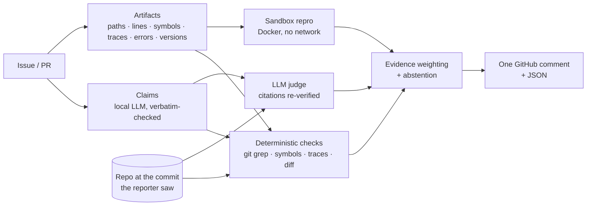

<div align="center">

# Nomi

### Evidence-based triage for GitHub issues and pull requests

**Nomi checks whether the *technical claims* in a bug report, security report or pull request are actually true, using the repository itself as the source of truth.**
For every claim it gives a verdict, links the exact lines of code that support or contradict it, and says plainly what it could not check.

[](https://github.com/UserAkku/nomi/actions/workflows/ci.yml)
[](https://github.com/UserAkku/nomi/releases)


-6f42c1)

[Quick start](#quick-start) · [How it works](#how-it-works) · [Results](#evaluation) · [Examples](examples/) · [Architecture](docs/architecture.md) · [Security](docs/security.md)

*Hacktoberfest 2026 Hack Day, Problem 02. Team **akku** (Akhilesh Kumar).*

</div>

---

## Contents

- [At a glance](#at-a-glance)
- [The problem](#the-problem)
- [What Nomi checks](#what-nomi-checks)
- [What a report looks like](#what-a-report-looks-like)
- [How it works](#how-it-works)
- [Verdicts and what they mean](#verdicts-and-what-they-mean)
- [Quick start](#quick-start)
- [Command reference](#command-reference)
- [Configuration](#configuration)
- [Running as a GitHub App](#running-as-a-github-app)
- [Evaluation](#evaluation)
- [The model and why](#the-model-and-why)
- [Design decisions and trade-offs](#design-decisions-and-trade-offs)
- [Safety and privacy](#safety-and-privacy)
- [FAQ](#faq)
- [Limitations and roadmap](#limitations-and-roadmap)
- [Project layout](#project-layout)
- [Development and contributing](#development-and-contributing)

## At a glance

| | |
|---|---|
| **Input** | A GitHub issue or PR URL, or a JSON file, analysed against the repository **as it was when the report was filed** |
| **Output** | One Markdown comment for maintainers, plus machine-readable JSON |
| **Verdict** | Per claim: *supported*, *contradicted*, *unverified* or *needs info*. Overall: *likely valid*, *likely invalid*, *needs more information* or an explicit *inconclusive* |
| **Evidence** | Permalinks pinned to the analysed commit, sandbox command output, diff hunks. Never model text on its own |
| **Model** | `qwen3:4b-instruct-2507-q4_K_M` running **locally** through Ollama on an 8 GB laptop. No cloud API, and no other model |
| **Works without a model** | Yes: `--no-llm` runs the deterministic checks in about 1 s per issue |
| **Never** | closes, labels, locks, merges or rejects anything. A maintainer always decides |
| **Results** | Caught **19/19** injected fabrications with **0/19** false alarms. Called **0** of 36 maintainer-confirmed bugs "invalid" across 128 real closed issues |

## The problem

Writing a convincing report has become cheap; verifying one is still expensive.

- **curl** ended its bug bounty in January 2026. AI-generated reports had pushed the share of genuine submissions below 5% in 2025, and each bogus report tied up 3–4 of the 7 security-team volunteers for between 30 minutes and 3 hours ([end of the bounty](https://daniel.haxx.se/blog/2026/01/26/the-end-of-the-curl-bug-bounty/), [death by a thousand slops](https://daniel.haxx.se/blog/2025/07/14/death-by-a-thousand-slops/), [the public list of slop reports](https://gist.github.com/bagder/07f7581f6e3d78ef37dfbfc81fd1d1cd)).
- **Hacktoberfest 2020** buried maintainers in README re-wordings and whitespace "fixes" until the rules changed to opt-in.
- Reports that *look* rigorous often fail on facts a machine can check: a function that does not exist, a line number past the end of the file, a stack trace whose frames don't match the code, a "fix" whose diff only moves spaces.

**What exists today, and the gap Nomi fills:**

| Approach | Typical signal | What it misses |
|---|---|---|
| Spam / "AI-slop" heuristics | account age, style, AI-likeness, volume | Penalises honest newcomers, and never asks whether the claim is *true* |
| Hosted AI reviewers and summarisers | a cloud model's opinion of the text | Unverifiable prose, closed models, nothing pinned to a commit |
| Fuzzing and repro infrastructure (OSS-Fuzz) | crashes it finds itself | Does not read reports at all |
| **Nomi** | **each claim checked against the code the reporter saw** | Semantic questions such as "is this intended behaviour?" (see [limitations](#limitations-and-roadmap)) |

> **Nomi checks claims, not authors.** It never scores writing style, account age or AI-likeness, because the task is whether a report is *true*, not who wrote it.

## What Nomi checks

| Check | What it verifies | Example of what it catches |
|---|---|---|
| **Files** (`grounding.file`) | Cited paths exist at the analysed commit. Paths from the reporter's own machine are recognised and skipped | `lib/vtls/openssl_ext.c` does not exist in curl |
| **Lines** (`grounding.line`) | `file:line` references fall inside the file | "`lib/easy.c` line 3412", but the file has 1,480 lines |
| **Symbols** (`grounding.symbol`) | Functions, classes and constants are defined or referenced in the repo (Python, JS/TS, C/C++, Go, Rust, Java/Kotlin/C#, Ruby, PHP) | `curl_easy_setopt_safe()` is not defined anywhere in curl |
| **Error messages** (`grounding.error_message`) | Quoted error text is actually produced by the project's code | supports the report when the message comes from `celery/utils/collections.py:114` |
| **CLI flags** (`grounding.flag`) | Flags mentioned in code spans exist in the source or docs | a `--retry-forever` flag the project never defines |
| **Stack traces** (`trace.frames`) | Each frame lands on a real line *inside the function it names* (Python, JS, Java, Go, Rust, C/ASan) | ASan frames pointing past the end of real files |
| **Quoted code** (`quote.code`) | Code "copied from the repo" really matches the repo. The reporter's own scripts and subclasses are recognised | a quoted body of `parse_url` that matches 2 of 9 lines |
| **Versions** (`version.release`) | Versions named for the project are real releases. Versions of other packages (`kombu:5.0.2`) are ignored | "version 9.9.0" when the newest tag is 5.0.0 |
| **PR vs diff** (`pr.*`) | Claimed tests or docs are really in the diff; mentioned files and symbols are touched; "no breaking changes" vs removed public API; whitespace-only "fixes" | "Adds unit tests" while no test file changed |
| **Reproduction** (`repro.*`) | A Python snippet from the report runs in a locked-down sandbox and raises the reported error **from repository code** | `ValueError: empty url` reproduced at the pinned commit |
| **Completeness** | Steps, expected vs actual, logs, code sample, version, environment | "Please share the full traceback and your Python version" |
| **Model judge** (behaviour claims) | For behaviour claims, the local model reads retrieved code and must cite exact lines. **Every citation is verified mechanically**; invented quotes are discarded | a citation of `raise ValueError("empty url")` at `parser.py#L9` |

## What a report looks like

Abridged from the [actual output](examples/curl-style-fabricated-report/report.md) for a constructed AI-slop-style security report against the **real curl repository**:

> **🟥 Likely invalid** · high confidence
> _Automated, evidence-based triage — not a final decision; a maintainer should confirm._
>
> | # | Claim | Verdict | Evidence |
> |---|---|---|---|
> | C1 | stack-based buffer overflow in `curl_easy_setopt_safe()` allows remote code execution … | ❌ contradicted · high | [lib/easy.c](https://github.com/curl/curl/blob/a133b27d0779fd6f74127139231efa456fdd2b44/lib/easy.c) |
> | C2 | `lib/easy.c` line 3412, `curl_easy_setopt_safe()` copies the redirect URL into a fixed 1024-byte stack buffer … | ❌ contradicted · high | [lib/easy.c](https://github.com/curl/curl/blob/a133b27d0779fd6f74127139231efa456fdd2b44/lib/easy.c) |
> | C6 | Remote code execution in every application using libcurl 8.4.0 … | 📝 needs info · low | — |
>
> *Why:* `curl_easy_setopt_safe` is not defined anywhere in curl at `a133b27`; `lib/easy.c` has 1,480 lines, not 3,412; the ASan frames point past the end of real files.

Each report also contains:
- the reasoning behind the verdict;
- a rationale for every claim;
- the missing information to ask the reporter for;
- suggested next steps;
- every check that ran, and why any could not;
- a limitations section.

More: a [fabricated report against a bundled C library](examples/fabricated-security-report/report.md), a [PR whose description does not match its diff](examples/pull-request-mismatch/report.md), and [three real closed issues](examples/real-issues/) (a hit, an abstention and a miss).

## How it works



1. **Intake.** Title, body and (for PRs) the diff. Labels, comments and close state are never read, because they are the maintainers' answer.
2. **Time-travel checkout.** The repository is cloned once, blobless, and each analysis gets its own git worktree:
   - for an issue, the default branch's last *first-parent* commit **before the issue was filed**, so a bug fixed later doesn't look made up;
   - for a PR, the head commit.
3. **Artifacts.** Regex-only extraction of file references, symbols, stack traces in six formats, error lines, versions, flags, CVE IDs and code blocks, written to be safe on hostile 200k-character input.
4. **Claims.** The local model returns schema-constrained JSON. Every quote is re-aligned to a **verbatim span of the report**, and unverifiable entities are dropped. Without a model, a rules-based extractor takes over.
5. **Deterministic checks.** Every check in the table above runs. Each emits a signal (supports, contradicts, missing info or neutral) with a strength between 0 and 1.
6. **Sandbox.** A self-contained Python snippet runs in Docker with no network and a read-only filesystem. Only an exception raised from repository code counts as "reproduced", and a clean run means "cannot reproduce", never "invalid".
7. **Judge.** BM25 retrieval over the code, then one model call per behaviour claim. The model must quote exact lines, and each quote is matched against the file. Model-only verdicts are capped at medium confidence.
8. **Assessment.** Transparent evidence weighting (see [verdicts](#verdicts-and-what-they-mean)) with guards against false accusations:
   - uncertain warnings are capped, so they can't add up to "invalid";
   - an isolated line mismatch among mostly-valid references is treated as a version difference;
   - a function that exists nowhere is never excused that way.
9. **Report.** GitHub-safe Markdown: user text escaped, @-mentions and autolinks neutralised, host paths scrubbed, size-capped below GitHub's comment limit. JSON is written alongside.

Full detail: [docs/architecture.md](docs/architecture.md).

## Verdicts and what they mean

| Overall verdict | Meaning | Typical trigger | Evaluation label |
|---|---|---|---|
| 🟥 **Likely invalid** | Key claims are contradicted by the code | A project function that does not exist, a line past the end of the file, a stack trace that doesn't match | `invalid` |
| 🟩 **Likely valid** | The evidence supports the report | Sandbox reproduction from repo code, matching stack frames, error text produced by the project | `confirmed` |
| 🟨 **Needs more information** | The report can't be verified as written | Missing steps, version or logs, or a snippet that runs cleanly in the sandbox | `cannot reproduce` |
| ⬜ **Inconclusive** | The evidence doesn't settle it, so Nomi abstains instead of guessing | Code that exists, but nothing proves or disproves the behaviour | *(abstain)* |

Confidence (*low*, *medium* or *high*) reflects how much independent, **deterministic** evidence agrees. A model's opinion alone can never produce *high*.

## Quick start

**Requirements**

| | Needed for | Notes |
|---|---|---|
| Python 3.11–3.13 and [uv](https://docs.astral.sh/uv/) | everything | `uv sync` installs the locked dependencies |
| git | everything | used for blobless clones, worktrees and `git grep` |
| [Ollama](https://ollama.com) with `qwen3:4b-instruct-2507-q4_K_M` | claim extraction and the judge | Optional: `--no-llm` works without it. A 2.5 GB download, about 4.1 GB in memory |
| Docker | sandbox reproduction | Optional: skipped, with the reason, when not running |
| `GITHUB_TOKEN` | fetching issues by URL | Optional: raises the GitHub API limit from 60 to 5,000 requests per hour |

```bash
git clone https://github.com/UserAkku/nomi && cd nomi
uv sync
ollama pull qwen3:4b-instruct-2507-q4_K_M      # optional, 2.5 GB
uv run nomi doctor                              # checks git, model, sandbox, GitHub access, chip temperature
```

**Analyse a real issue.** It is fetched, the repo is cloned and checked out at the issue's date, and the report is printed:

```bash
uv run nomi analyze https://github.com/celery/celery/issues/6381
```

**Fully offline**, on a bundled example:

```bash
uv run nomi analyze --input-file examples/fabricated-security-report/input.json \
  --repo-path examples/fabricated-security-report/repo --no-llm
```

**A pull request**, checking the description against its diff:

```bash
uv run nomi analyze https://github.com/OWNER/REPO/pull/123 --format both --out report/
```

## Command reference

| Command | Purpose |
|---|---|
| `nomi analyze TARGET` | Verify one issue or PR. `TARGET` is a URL or `owner/repo#number` |
| `nomi eval DATASET.jsonl` | Score Nomi against closed issues whose labels are the reference answers |
| `nomi dataset build --repo OWNER/NAME --out FILE` | Collect closed issues labelled invalid, cannot reproduce or confirmed |
| `nomi serve` | Run the GitHub App webhook server |
| `nomi doctor` | Check the environment |
| `nomi version` | Print the version |

`nomi analyze` options:

| Option | Effect |
|---|---|
| `--input-file PATH` | Read the submission from JSON (`examples/*/input.json` shows the format) |
| `--repo-path PATH` | Verify against a local checkout instead of cloning |
| `--at-head` | Use the latest commit instead of the one from when the issue was filed |
| `--no-llm` | Deterministic checks only |
| `--no-sandbox` | Never execute snippets |
| `--format md\|json\|both` / `--out DIR` | Output format and destination (default: Markdown to stdout) |
| `--model TAG` | Use another Ollama model tag |

`nomi eval` options:
- `--no-llm` and `--no-sandbox`;
- `--limit N` to score only the first N issues;
- `--out DIR`, which is resumable and refuses to resume when the dataset or configuration changed;
- `--fresh` to start over;
- `--max-temp 85 --cooldown 20` to pace long runs by chip temperature.

## Configuration

Every setting is an environment variable, or a line in `.env` (see [`.env.example`](.env.example)).

| Variable | Default | Purpose |
|---|---|---|
| `NOMI_LLM_MODEL` | `qwen3:4b-instruct-2507-q4_K_M` | Ollama model tag |
| `OLLAMA_HOST` / `NOMI_OLLAMA_HOST` | `http://localhost:11434` | Ollama server address |
| `NOMI_LLM_ENABLED` | `true` | Turn the model off globally |
| `NOMI_LLM_NUM_CTX` | `8192` | Context window (KV-cache memory grows with it) |
| `NOMI_LLM_TIMEOUT_S` | `240` | Per-request timeout |
| `NOMI_LLM_MAX_CLAIMS` | `6` | Maximum claims extracted per report |
| `NOMI_CACHE_DIR` | `~/.cache/nomi` | Clones, worktrees and the model-response cache |
| `GITHUB_TOKEN` / `GH_TOKEN` | — | GitHub API token (read-only is enough for `analyze`) |
| `NOMI_SANDBOX_ENABLED` | `true` | Allow Docker reproduction |
| `NOMI_SANDBOX_IMAGE` | `python:3.12-slim` | Sandbox image |
| `NOMI_SANDBOX_TIMEOUT_S` / `_MEMORY` / `_CPUS` | `60` / `512m` / `1.0` | Sandbox limits |
| `NOMI_APP_ID`, `NOMI_APP_PRIVATE_KEY_PATH`, `NOMI_WEBHOOK_SECRET` | — | GitHub App credentials |
| `NOMI_DRY_RUN` | `true` | Write reports to `NOMI_OUTPUT_DIR` instead of posting |
| `NOMI_OUTPUT_DIR` | `nomi-reports` | Where dry-run reports go |

## Running as a GitHub App

```bash
export NOMI_WEBHOOK_SECRET=change-me NOMI_DRY_RUN=true
uv run nomi serve --port 8000
uv run python scripts/replay-webhook.py celery/celery 6381     # signed test delivery, no app registration needed
```

- **Events:** `issues.opened` and `reopened`, `pull_request.opened`, `synchronize`, `reopened` and `ready_for_review`, and `/nomi` comments from owners, members and collaborators.
- **Webhooks:** HMAC-verified, and the server **fails closed** when no secret is set. Deliveries are de-duplicated, events from bots are ignored, and jobs are coalesced per issue/PR on one serialized worker, since a local model serves one request at a time.
- **Output:** a single comment that is updated in place, never a new comment per run.
- **Permissions:** minimal, as declared in [`app.yml`](app.yml): metadata read, contents read, issues write, pull requests write.
- **Dry run:** on by default. Reports are written to disk until you opt in on a repository you maintain.

Setup guide: [docs/github-app.md](docs/github-app.md).

## Evaluation

All numbers are real runs on an 8 GB MacBook Pro M3. Per-issue predictions and full metrics are in [examples/evaluation/](examples/evaluation/).

**Method**
- **Dataset.** 128 closed issues from celery, poetry and pylint, labelled by their maintainers as *invalid*, *cannot reproduce* or *confirmed*. They are split deterministically into dev (37) and a held-out test set (91); see the [dataset notes](data/eval/README.md).
- **No leakage.** Nomi sees only the title, body and creation time, and verifies against the repo as it was when each issue was filed.
- **Metrics:**
  - per-class precision, recall and F1, plus macro-F1;
  - coverage and selective accuracy (Nomi may abstain);
  - the **false-invalid rate**: confirmed bugs called invalid, the most harmful error.

**1. Fabrication benchmark: does Nomi catch invented claims?**
- **Setup.** Each of 19 maintainer-confirmed test issues is kept as a control. It also gets a twin with an added curl-style root cause: a plausible but non-existent function, and a line past the end of a real file at the issue's commit.
- **Built by** [`scripts/make-injection-set.py`](scripts/make-injection-set.py) using one template. Six of the 25 confirmed issues had no suitable target file and were left out.

| Fabricated twins flagged *likely invalid* | Genuine controls flagged *invalid* | Selective accuracy |
|:---:|:---:|:---:|
| **19 / 19** | **0 / 19** | 96.6 % |

**2. Real maintainer labels: 91 held-out issues**

| Metric | Nomi | Majority baseline |
|---|---:|---:|
| False-invalid rate (confirmed bugs called *invalid*) | **0 %** (0 / 25) | 100 % (25 / 25) |
| Selective accuracy (answered items) | 46.7 % | 38.5 % |
| Coverage (answered instead of abstaining) | 65.9 % | 100 % |
| Macro F1 | 0.32 | 0.19 |

Across all 128 labelled issues (test + dev), Nomi never called a confirmed bug *invalid*.

**3. Local model vs deterministic checks: same 24-issue subset, same commit**

| | Deterministic | + Qwen3 4B |
|---|---:|---:|
| Correct | 7 / 24 | 8 / 24 |
| Selective accuracy | 50.0 % | 53.3 % |
| Time per issue | about 1 s | about 1–3 min uncached |

**What this means**
- **The core job works.** Invented functions, files and line numbers are caught, and no real bug was dismissed.
- **Maintainer labels are not truth labels.** In these repositories *invalid* usually means "usage question" or "works as designed": the reported code really exists, so a code-grounded check cannot call those reports false. Nomi never answers *invalid* for them, and its *invalid* recall on real labels is 0. That is the main roadmap item.
- **The model adds a little on label agreement (8 vs 7), too little to claim a gain on 24 issues.** Its real value is splitting reports into individual claims and giving line-cited explanations. Verdict-changing evidence is deterministic by design, so a 4B model's mistakes cannot produce a false "invalid".

```bash
uv run nomi eval data/eval/test.jsonl --no-llm --out eval-runs/test
uv run python scripts/make-injection-set.py data/eval/test.jsonl data/eval/injected-test.jsonl
uv run nomi eval data/eval/injected-test.jsonl --no-llm --out eval-runs/injected
uv run nomi eval data/eval/test-small.jsonl --max-temp 85 --cooldown 20 --out eval-runs/model
```

## The model and why

**Qwen3 4B Instruct 2507** (`qwen3:4b-instruct-2507-q4_K_M`, Apache-2.0), served by Ollama on the laptop itself.

| Candidate | Size | Decision |
|---|---|---|
| **Qwen3 4B Instruct 2507 Q4_K_M** | 2.5 GB | **Chosen.** Strongest published non-thinking instruction-following and structured-output scores that fit 8 GB (IFEval 83.4, BFCL-v3 61.9, MMLU-Pro 69.6). No thinking mode, so JSON comes back fast and clean. 256K native context |
| Gemma 4 E2B / E4B | 4.3–9.6 GB | Too large for 8 GB alongside macOS and Docker |
| Qwen3.5 4B | 3.3–4 GB | Carries a vision encoder we don't need |
| Qwen2.5-Coder 7B | 4.7 GB | Leaves no headroom for the KV cache |
| Embedding models | 0.3–1.2 GB | For code identifiers, BM25 + `git grep` was more precise and costs no memory |

**Measured on the M3:**
- about 25 tokens/s, and 4.1 GB resident with an 8K context, fully on the GPU;
- 1–3 minutes per model-backed analysis uncached, with responses cached by a hash of (model, prompt, schema, options).

**Thermal pacing.** Sustained back-to-back inference pushed the chip to about 99 °C. `nomi eval --max-temp 85 --cooldown 20` reads the SoC sensors (IOHID, no sudo) and waits for the chip to cool, which kept long runs between 60 and 85 °C.

**Not trusted with evidence.** In our first benchmark, the model rewrote "line 3412" as "line 3416" inside a quote it was told to copy verbatim. That is why every quote and citation is matched mechanically before it counts.

## Design decisions and trade-offs

| Decision | Why | Trade-off |
|---|---|---|
| Deterministic checks outrank the model | Existence checks are exact, cheap, and hard to fool with confident prose or prompt injection | Behaviour claims about code that *does* exist need the model or a reproduction |
| Time-travel checkout (first-parent, before the issue was filed) | Avoids accusing a reporter of fabrication because the code changed afterwards | Users on an old release may see code that differs from the default branch at that date. Version mentions are cross-checked against tags, and installed-release frames are softened |
| One git worktree per commit | Concurrent analyses (the CLI next to the webhook server) never share a checkout | Disk usage. Worktrees are pruned, but never while recently used |
| BM25 + `git grep` instead of embeddings | Code identifiers match exactly, and no second model competes for 8 GB | Weaker on paraphrased natural-language queries |
| "Not reproduced" ≠ "invalid" | Environments differ, so a failed reproduction means *cannot reproduce* | Fewer confident "invalid" verdicts |
| Abstention is a verdict | A wrong "invalid" on a real bug costs a contributor and a maintainer | Lower coverage. Selective accuracy is reported separately |
| Uncertain signals are capped | Ten "maybe from a dependency" warnings must not add up to "fabricated" | Some genuinely sloppy reports stay *inconclusive* |
| No author or "AI-likeness" signals | The task is whether claims are true. Identity heuristics hurt honest newcomers | Spam waves are caught only through their claims and diffs |
| One serialized worker for the App | The local model serves one request at a time. Webhooks are acknowledged in under 1 s | Throughput is about one report per 1–3 minutes |
| Thermal pacing | Protects an 8 GB laptop during long runs without switching to a weaker model | Long evaluations take longer |

## Safety and privacy

- **Untrusted code never runs on the host.** The sandbox runs with:
  - `--network none` and `--read-only`;
  - `--cap-drop ALL`, `no-new-privileges` and a non-root user;
  - pid, memory and CPU limits, with no host environment passed in;
  - an external timeout that kills the container;
  - bounded output.
- **Untrusted files are read safely.** Tracked symlinks, FIFOs and devices in a checked-out PR are never followed, and reads are bounded.
- **Webhooks are verified.** They are HMAC-checked and fail closed; deliveries are de-duplicated, bots are ignored, and `/nomi` re-runs are limited to maintainers.
- **Reports are injection-safe.** User text is escaped, @-mentions and autolinks are neutralised, and host paths are scrubbed. The bot only edits comments it authored itself.
- **Minimal footprint.** The app asks for minimal permissions and runs in dry-run by default. No secrets live in the repository: `.env` and `*.pem` are git-ignored, and CI uses a read-only token with actions pinned to full commit SHAs.

Threat model: [docs/security.md](docs/security.md). Reporting a vulnerability: [SECURITY.md](SECURITY.md).

## FAQ

<details><summary><b>Does Nomi detect AI-written reports?</b></summary>

No, and that is deliberate. A report is judged by whether its technical claims hold up against the code. A human's fabricated report and an AI's accurate one are treated on their merits.
</details>

<details><summary><b>Will it close or label issues?</b></summary>

Never. It posts (or, in dry-run, writes) one evidence report. Every decision stays with a maintainer.
</details>

<details><summary><b>Does my code or report leave the machine?</b></summary>

The model runs locally through Ollama. Nomi talks to the GitHub API to fetch the issue or PR (and, with posting enabled, to write the comment), and clones the public repository. Nothing is sent to a model provider.
</details>

<details><summary><b>Can I use it without a GPU or a model?</b></summary>

Yes. `--no-llm` runs every deterministic check in about 1 s per issue. All the headline numbers above come from deterministic mode.
</details>

<details><summary><b>Which languages are supported?</b></summary>

Static checks work for Python, JavaScript/TypeScript, C/C++, Go, Rust, Java/Kotlin/C#, Ruby and PHP. Stack traces are parsed for Python, JS/Node, Java, Go, Rust and C (gdb/ASan). Sandbox reproduction is currently Python-only.
</details>

<details><summary><b>Why is a model-backed analysis slow?</b></summary>

A 4B model on an 8 GB laptop generates about 25 tokens/s. Claim extraction plus up to four judged claims takes 1–3 minutes. Responses are cached, so re-runs are fast.
</details>

## Limitations and roadmap

- [ ] **"Works as designed" reports.** Check claims against the project's own docs and docstrings ("documented behaviour") before calling them supported. This is the biggest gap on real *invalid* labels.
- [ ] **Project naming conventions.** Use conventions such as curl's `Curl_` prefix to attribute unknown symbols, so a few invented names become *contradicted* rather than *unverified*.
- [ ] **Reproduction beyond Python.** Compiled reproducers under sanitizers, repeated runs to separate flaky from reliable results, and gVisor (`runsc`) for stronger isolation.
- [ ] **Release-aware checkout.** When a report names a release, check it against that tag's tree as well as the default branch at that date.
- [ ] **Check Runs and labels in the App.** A `nomi:*` label set, not a maintainer verdict.

Known limits:
- Maintainer labels are noisy proxies for truth.
- Semantic claims ("this is exploitable") need reasoning beyond a 4B model, so Nomi says *unverified* instead of guessing.

## Project layout

```
src/nomi/
  cli.py          nomi analyze / eval / dataset / serve / doctor
  pipeline.py     one analysis end to end; graceful degradation
  models.py       domain model: Submission, Claim, Check, Evidence, Report
  extract/        artifacts.py (regex), completeness.py, claims.py (LLM + rules)
  verify/         grounding, traces, quotes, versions, pr, sandbox, judge
  repo/           workspace.py (pinned worktrees, git grep), symbols.py, search.py (BM25)
  llm/            ollama.py (schema-constrained, cached), fake.py (tests)
  github/         client, app (webhooks), auth (JWT), publish, service
  eval/           dataset, runner (resumable, manifest), metrics
  assess.py       evidence weighting and verdicts
  report.py       GitHub-safe Markdown + JSON
  thermal.py      SoC temperature and pacing (macOS)
tests/            about 1,150 unit and integration tests
examples/         inputs and actual outputs; evaluation results
data/eval/        labelled dataset (dev, test, test-small, injection benchmark)
docs/             architecture, security, GitHub App setup, review findings
scripts/          regenerate examples, build the injection set, replay a webhook
```

## Development and contributing

```bash
uv sync
uv run pytest                                  # no network or model needed; Docker tests skip without Docker
uv run ruff check . && uv run ruff format --check .
```

**Branch flow:** work branch → PR into `dev` → release PR `dev` → `main`.
- After the two initial setup commits, nothing was pushed to `main` directly.
- Every PR uses the [PR template](.github/pull_request_template.md), which names the models and AI coding assistants used.
- Every PR must pass [CI](.github/workflows/ci.yml): ruff lint and format, about 1,150 tests on Python 3.11–3.13 including real Docker sandbox tests, and an end-to-end smoke test of the CLI.

**Quality process.** Before release the code went through an **adversarial review** by four independent reviewers, each with one lens (security, false accusations, robustness, evaluation validity).
- All 23 reproduced findings were fixed, 22 with regression tests ([list](docs/review-findings.md), [#4](https://github.com/UserAkku/nomi/pull/4)).
- A final judge-eye verification of a fresh clone led to one more polish PR ([#7](https://github.com/UserAkku/nomi/pull/7)).

See [CONTRIBUTING.md](CONTRIBUTING.md) and [SECURITY.md](SECURITY.md).

**Built with:**
- Coding agent: Claude Code.
- Model used by the product: Qwen3 4B Instruct 2507, local via Ollama.
- Research starting points: curl's bug bounty and AI-contribution policy, the Hacktoberfest 2020 spam wave, OSS-Fuzz's reproducibility model, and bug-report quality research (Bettenburg et al., FSE 2008).

## License

[Apache-2.0](LICENSE)
