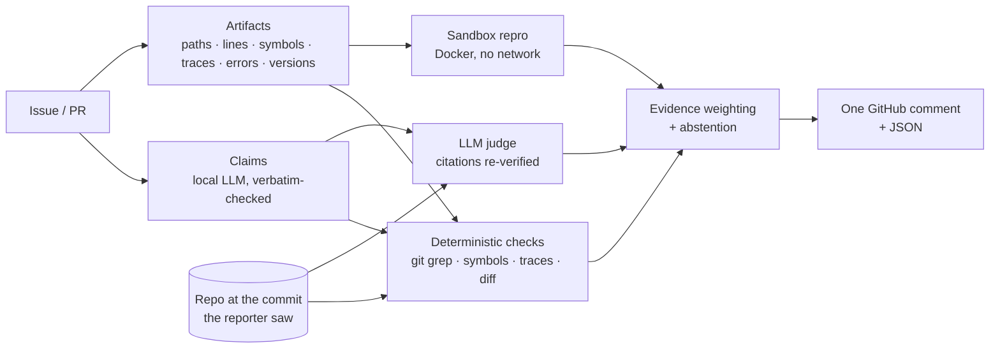

# Nomi

**Evidence-based triage for GitHub issues and pull requests.** Nomi checks whether the *technical claims* in a bug report, security report or PR are true, using the repository itself as the source of truth. It tells maintainers what it verified, what it contradicted and what it could not check, with a commit-pinned permalink for every piece of evidence.

[](https://github.com/UserAkku/nomi/actions/workflows/ci.yml)

-6f42c1)

*Hacktoberfest 2026 Hack Day, Problem 02. Team **akku** (Akhilesh Kumar).*

---

## The problem

Writing a convincing report is now cheap, and verifying one is still expensive.
- **curl** ended its bug bounty in January 2026, after AI-generated reports pushed the share of genuine submissions below 5%. Each bogus report tied up 3–4 maintainers for 30 minutes to 3 hours ([Stenberg](https://daniel.haxx.se/blog/2026/01/26/the-end-of-the-curl-bug-bounty/)).
- **Hacktoberfest 2020** buried maintainers in README re-wordings and whitespace "fixes".

The telltale signs are usually checkable: a function that doesn't exist, a line number past the end of the file, a stack trace whose frames don't match the code, a "fix" whose diff only moves spaces.

Most existing tools score *who* wrote something (account age, AI-likeness) or summarise with a cloud model. Neither checks whether the cited function exists at the commit the reporter was looking at. **Nomi checks claims, not authors.**

## What a report looks like

Abridged from the [actual output](examples/curl-style-fabricated-report/report.md) for a constructed AI-slop-style security report against the **real curl repository**:

> **🟥 Likely invalid** · high confidence
> _Automated, evidence-based triage — not a final decision; a maintainer should confirm._
>
> | # | Claim | Verdict | Evidence |
> |---|---|---|---|
> | C1 | stack-based buffer overflow in `curl_easy_setopt_safe()` allows remote code execution … | ❌ contradicted · high | [lib/easy.c](https://github.com/curl/curl/blob/a133b27d0779fd6f74127139231efa456fdd2b44/lib/easy.c) |
> | C2 | `lib/easy.c` line 3412, `curl_easy_setopt_safe()` copies the redirect URL into a fixed 1024-byte stack buffer … | ❌ contradicted · high | [lib/easy.c](https://github.com/curl/curl/blob/a133b27d0779fd6f74127139231efa456fdd2b44/lib/easy.c) |
> | C6 | Remote code execution in every application using libcurl 8.4.0 … | 📝 needs info · low | — |
>
> *Why:* `curl_easy_setopt_safe` is not defined anywhere in curl at `a133b27`; `lib/easy.c` has 1,480 lines, not 3,412; the ASan frames point past the end of real files.

Every link is pinned to the analysed commit. Checks that could not run (no Docker, no model) are listed with the reason, never skipped silently. See [all examples](examples/).

## How it works



1. **Time-travel checkout.** Historical issues are checked against the default branch **as it was when the issue was filed**, so a bug fixed later doesn't look made up.
2. **Deterministic checks first.** Do cited files, lines, functions, flags and error strings exist? Do stack-trace frames land inside the functions they name? Does "quoted" code match? For PRs: tests claimed vs tests changed, "no breaking changes" vs removed public functions, whitespace-only "fixes".
3. **Safe reproduction.** A Python snippet from the report runs in a locked-down container: no network, read-only, non-root, capped CPU, memory and time, no secrets.
4. **The model proposes, tools verify.** A local model splits the report into claims and judges retrieved code. Every quote and citation it returns is matched mechanically, and anything that doesn't match is discarded.
5. **Calibrated output.** Per-claim verdicts (supported / contradicted / unverified / needs info) roll up to *likely valid*, *likely invalid*, *needs more information* or an explicit **inconclusive**.

Details: [docs/architecture.md](docs/architecture.md) · [docs/security.md](docs/security.md) · [docs/github-app.md](docs/github-app.md)

## Quick start

Requires Python ≥ 3.11, git, and [uv](https://docs.astral.sh/uv/). [Ollama](https://ollama.com) and Docker are optional; Nomi degrades gracefully without them.

```bash
git clone https://github.com/UserAkku/nomi && cd nomi
uv sync
ollama pull qwen3:4b-instruct-2507-q4_K_M   # 2.5 GB, runs on an 8 GB laptop
uv run nomi doctor                          # checks git, model, sandbox, GitHub access, chip temperature
```

Analyse a real issue. It is fetched, the repo is cloned blobless and checked out at the issue's date, and the report is printed:

```bash
uv run nomi analyze https://github.com/celery/celery/issues/6381
```

Or run fully offline on a bundled example:

```bash
uv run nomi analyze --input-file examples/fabricated-security-report/input.json \
  --repo-path examples/fabricated-security-report/repo --no-llm
```

Useful flags: `--no-llm` (deterministic only), `--no-sandbox`, `--at-head`, `--format md|json|both`, `--out DIR`. Set `GITHUB_TOKEN` to raise the GitHub API limit from 60 to 5,000 requests per hour.

## Evaluation

Full write-up and raw predictions: [examples/evaluation/](examples/evaluation/). Every number below comes from a real run on this 8 GB M3.

**1. Fabrication benchmark.** Each of 19 maintainer-confirmed test issues is kept as a control, and given a twin with an added curl-style fabricated root cause: a plausible non-existent function, and a line past the end of a real file at the issue's commit. Six of the 25 confirmed issues had no suitable target file and were left out. All twins use one injection template, so treat this as a controlled check, not a field study. Built by [`scripts/make-injection-set.py`](scripts/make-injection-set.py).

| Fabricated twins flagged *likely invalid* | Genuine controls flagged *invalid* |
|:---:|:---:|
| **19 / 19** | **0 / 19** |

**2. Real maintainer labels.** 91 held-out closed issues from celery, poetry and pylint ([dataset](data/eval/README.md)). Nomi sees only title and body, checked against the repo as it was when each issue was filed.

| Metric | Nomi | Majority baseline |
|---|---:|---:|
| False-invalid rate (confirmed bugs called *invalid*) | **0 %** (0 / 25) | 100 % (25 / 25) |
| Selective accuracy (answered items) | 46.7 % | 38.5 % |
| Coverage (answered instead of abstaining) | 65.9 % | 100 % |
| Macro F1 | 0.32 | 0.19 |

**What this means.** Nomi reliably catches invented functions, files and line numbers, and it never dismissed a real bug. Maintainer *invalid* labels mostly mean "usage question" or "works as designed", where the reported code really exists, so code-grounded checks cannot call those reports false. Nomi never answers *invalid* for them; it says *needs more information*, *likely valid* or *inconclusive* instead, so its *invalid* recall on real labels is 0. On a 24-issue subset, with both runs on the same commit, the local model improved label agreement only slightly over deterministic checks: 8 vs 7 correct, selective accuracy 53.3 % vs 50.0 %. That is too few issues to claim a real gain, and we say so. The model's job is to break a report into individual claims and give line-cited explanations; verdict-changing evidence is deterministic by design.

```bash
uv run nomi eval data/eval/test.jsonl --no-llm --out eval-runs/test
uv run nomi eval data/eval/test-small.jsonl --max-temp 85 --cooldown 20 --out eval-runs/model
```

## Design decisions and trade-offs

| Decision | Why | Trade-off |
|---|---|---|
| **Qwen3 4B Instruct 2507** (Q4_K_M) via Ollama | Best published instruction-following and structured-output scores that fit 8 GB (IFEval 83.4, BFCL-v3 61.9). No thinking mode, so JSON is fast and clean. Measured about 25 tokens/s on an M3. | A 4B model misjudges subtle semantics, so it is never allowed to be the evidence, and its verdicts are capped at medium confidence. |
| Deterministic checks outrank the model | Existence checks are exact and hard to fool with confident prose (or prompt injection). | Behaviour claims about code that *does* exist need the model or a reproduction. |
| Time-travel checkout | Avoids accusing a reporter of fabrication because the code changed after they filed. | Users on an old release may see code that differs from the default branch at that date. Version mentions are cross-checked against tags. |
| BM25 + `git grep` instead of embeddings | Code identifiers match exactly, and no second model has to share 8 GB of RAM. | Weaker on paraphrased natural-language queries. |
| "Not reproduced" ≠ "invalid" | Environment differences are common, so a failed reproduction is *cannot reproduce*. | Fewer confident "invalid" verdicts. |
| Abstention is a verdict | A wrong "invalid" on a real bug costs a contributor and a maintainer. Saying "inconclusive" is honest. | Lower coverage. Selective accuracy is reported separately. |
| No author or "AI-likeness" signals | The task is whether claims are true. Identity heuristics hurt honest newcomers. | Spam waves are caught only through their claims and diffs. |
| Thermal pacing (`--max-temp`, `--cooldown`) | Sustained local inference drove an 8 GB M3 to ~99 °C. Evaluation now waits for the chip to cool, and `nomi doctor` shows the temperature, read via IOHID without sudo. | Long runs take longer. |
| One background worker | The local model serves one request at a time. Webhooks are acknowledged in under 1 s. | Throughput is about one report per 1–2 minutes on an 8 GB laptop. |

## Safety

Untrusted text and code never run on the host. Webhooks are HMAC-verified and fail closed, deliveries are de-duplicated, and bots are ignored. The app asks for minimal permissions and runs in **dry-run by default**. It never closes, labels or rejects anything. See [docs/security.md](docs/security.md).

## Limitations and roadmap

- **"Works as designed" reports** are the main gap. Next step: cross-check a claim against the project's own docs and docstrings ("documented behaviour") before calling it supported.
- **Dynamic reproduction** covers self-contained **Python** snippets only. Other languages get static verification.
- **Semantic claims** ("this is exploitable") need reasoning beyond a 4B model. Nomi says *unverified* rather than guessing.
- **Project naming conventions** (e.g. curl's `Curl_` prefix) are not yet used to attribute unknown symbols to the project, so a few invented names stay *unverified* instead of *contradicted*.
- **Maintainer labels are noisy proxies for truth.** See the dataset notes.

## Development

```bash
uv sync
uv run pytest            # unit + integration tests (no network, no model needed)
uv run ruff check .
```

Branch flow: **work branch → PR into `dev` → release PR `dev` → `main`**. After the two initial setup commits, nothing was pushed to `main` directly. Every PR uses the [PR template](.github/pull_request_template.md), which names the models and AI coding assistants used, and must pass [CI](.github/workflows/ci.yml): lint, about 1,100 tests on Python 3.11–3.13 including real Docker sandbox tests, and an end-to-end smoke test. Before release, the code went through an adversarial review: four independent reviewers, each with one lens. All 23 reproduced findings were fixed, 22 with regression tests ([list](docs/review-findings.md), [#4](https://github.com/UserAkku/nomi/pull/4)). See [CONTRIBUTING.md](CONTRIBUTING.md) and [SECURITY.md](SECURITY.md).

```
src/nomi/
  extract/   artifacts, completeness, claims (LLM + rules)
  verify/    grounding, traces, quotes, versions, pr, sandbox, judge
  repo/      workspace (pinned checkout), symbols, search (BM25)
  github/    client, app (webhooks), auth, publish, service
  eval/      dataset, runner, metrics
  assess.py  report.py  pipeline.py  cli.py  thermal.py
```

## License

[Apache-2.0](LICENSE)
