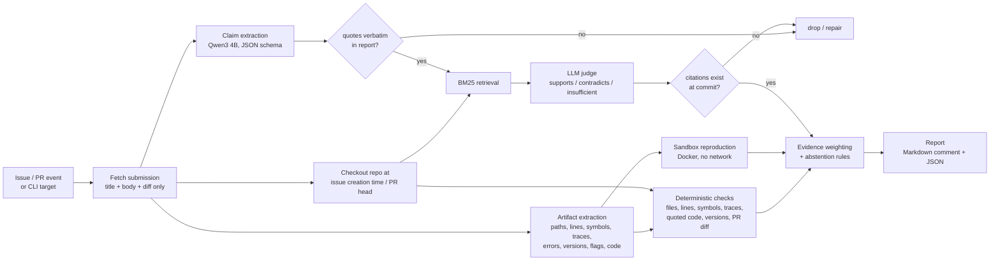

# Architecture

Nomi answers one question for a maintainer: **which of the technical claims in this issue or pull request are true, and how do we know?**

## Principles

1. **Claims, not authors.** Nomi never scores writing style, account age or "AI-likeness". GitHub's own docs and the Hacktoberfest 2020 aftermath both show that identity heuristics hurt honest newcomers. A fabricated report is caught because its claims fail verification, not because it reads like AI.
2. **Deterministic evidence first.** git, symbol lookup, stack-trace and diff analysis are exact and cheap, so they run first and carry the most weight.
3. **The model proposes, tools verify.** The local model (Qwen3 4B Instruct 2507) only does two narrow, schema-constrained jobs: split a report into claims, and judge retrieved code against one claim. Every quote and citation it returns is matched mechanically against the issue text or the repository, and anything that does not match is dropped. LLM-only judgements are never rated "high" confidence.
4. **Pinned evidence.** Every piece of evidence is a `path#Lx-Ly` permalink at the exact commit that was analysed. Historical issues are checked against the default branch **as it was when the issue was filed** (time-travel checkout), so a bug fixed later is not mistaken for a made-up one.
5. **Abstain instead of guessing.** "Inconclusive" is a first-class verdict. "Could not run" is always reported with its reason.
6. **Assist, never act.** Nomi writes one updatable comment. It never closes, labels, merges or rejects.

## Pipeline

| Stage | Module | Model? | What it produces |
|---|---|---|---|
| Intake | `github/client.py` | no | `Submission` (labels, comments and close state are deliberately excluded) |
| Checkout | `repo/workspace.py` | no | blobless clone, `git rev-list --before=<created_at>`, detached checkout |
| Artifacts | `extract/artifacts.py` | no | file refs, `file:line`, symbols, stack traces (Python/JS/Java/Go/Rust/C+ASan), errors, versions, flags, code blocks |
| Completeness | `extract/completeness.py` | no | which report sections exist (repro steps, expected/actual, version, environment, logs, code) |
| Claims | `extract/claims.py` | yes | atomic claims; quotes re-aligned to verbatim spans; rules fallback without a model |
| Grounding | `verify/grounding.py` | no | do cited files, lines, symbols, flags and error strings exist at the commit? |
| Traces | `verify/traces.py` | no | do stack-trace frames land inside the functions they name? |
| Quoted code | `verify/quotes.py` | no | does code "copied from the repo" actually match the repo? |
| Versions | `verify/versions.py` | no | is the claimed version a real release, and were newer ones out? |
| PR checks | `verify/pr.py` | no | description vs diff: tests/docs claimed, files/symbols mentioned, whitespace-only "fixes", "no breaking change" vs removed public API |
| Reproduction | `verify/sandbox.py` | no | runs the report's Python snippet in a locked-down container and compares the exception |
| Judge | `repo/search.py`, `verify/judge.py` | yes | per-claim supports/contradicts/insufficient with mechanically verified line citations |
| Assessment | `assess.py` | no | per-claim verdicts, overall verdict, reasons, missing information, next steps, limitations |
| Report | `report.py` | no | GitHub-safe Markdown (escaped, no @-mentions, size-capped) and JSON |

## How the verdict is decided

Each check emits a `signal` (supports / contradicts / missing info / neutral) and a `strength` from 0 to 1. Strength reflects how hard the evidence is to fake or misread:

| Evidence | Signal | Strength |
|---|---|---|
| Snippet reproduces the reported exception in the sandbox | supports | 0.9 |
| Function attributed to the project is not defined anywhere at the commit | contradicts | 0.8 |
| Cited line is past the end of the file | contradicts | 0.75 |
| Cited project file does not exist | contradicts | 0.7 |
| Stack-trace frames don't match the named functions | contradicts | 0.4–0.65 |
| Stack-trace frames match real lines in the named functions | supports | 0.35–0.6 |
| PR claims tests but changes no test file | contradicts | 0.6 |
| Quoted error text is produced by the project's code | supports | 0.35 |
| Cited symbol/file exists | supports | 0.15 (capped in total) |

The rules, in order (`assess.py`):
1. A hard contradiction (≥ 0.7) → **Likely invalid**, unless the sandbox reproduced the bug, which gives **Inconclusive** (conflicting strong evidence).
2. A sandbox reproduction → **Likely valid**.
3. A very incomplete report with no supporting evidence → **Needs more information**.
4. Net evidence score ≥ +0.6 → Likely valid. ≤ −0.6 → Likely invalid.
5. Otherwise an incomplete report → Needs more information, else **Inconclusive**.

Two guards keep weak evidence from adding up to an accusation:
- **Uncertain warnings are capped.** All "not found here, may come from a dependency" contradictions together count for at most 0.4, so a traceback full of the reporter's own paths cannot sum to "invalid".
- **Version skew.** When at least three cited references hold and they outnumber the failures 2:1, an isolated *line or stack-frame* mismatch is treated as a probable version difference. A function or file that exists nowhere is never excused this way.

A sandbox run that does **not** reproduce the bug maps to *needs more information* ("cannot reproduce"), never to *invalid*.

Confidence comes from how much independent, deterministic evidence agrees. A model's opinion alone can never produce high confidence.

## Running on an 8 GB laptop

- One model, Q4_K_M, 2.5 GB, `num_ctx` 8192: about 3.7 GB with the KV cache.
- Requests are serialised: the GitHub App runs one background worker, because the local model serves one request at a time anyway.
- Model responses are cached on disk by a hash of (model, prompt, schema, options), so evaluation reruns are reproducible and nearly free.
- Retrieval is BM25 plus `git grep`, not embeddings. Code identifiers are matched exactly, and no second model has to sit in memory.
